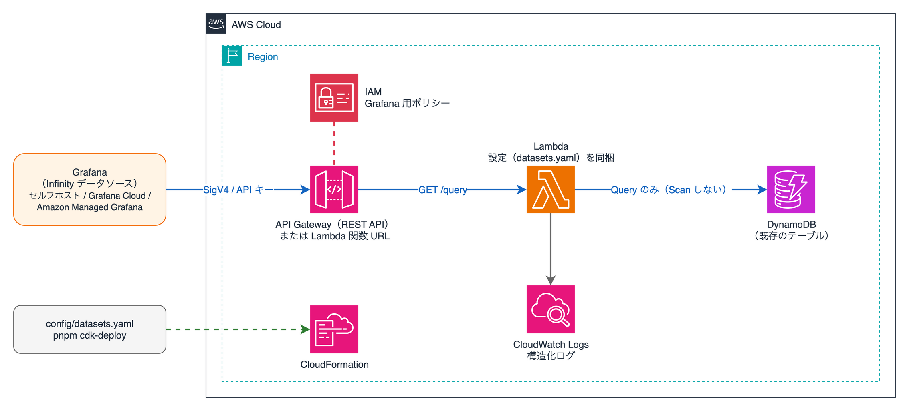

# timeseries-dataset-api-for-amazon-dynamodb

[English](README.md) | 日本語

[](https://github.com/furuya02/timeseries-dataset-api-for-amazon-dynamodb/actions/workflows/ci.yml)
[](LICENSE)

Amazon DynamoDB の時系列データを、Grafana（Infinity データソース）から読むための API です。
設定ファイル 1 つ（`config/datasets.yaml`）に「どのテーブルの、どのキーの、どの属性を返すか」を書き、AWS CDK でデプロイします。



## 特徴

- **どの Grafana からでも使える**: プラグインではなく API なので、セルフホストの Grafana、Grafana Cloud、Amazon Managed Grafana から Infinity データソースで接続できます
- **設定ファイル 1 つ**: テーブル設計（プレフィックス付きのキー、複合ソートキー、日付で分けたキー、GSI、ISO 8601 / epoch）を `datasets.yaml` に書くだけです。誤りは `cdk synth` の時点で一覧表示します
- **Scan しない**: DynamoDB の Query API だけを使います。期間、件数、ページ数、消費 RCU に上限を設けられます
- **API 側で集計**: ダウンサンプリング（avg / min / max / sum / count / last）と最新値の取得を API で行い、Grafana のアラートにも使えます
- **最小権限**: Lambda には設定に書いたテーブルへの `dynamodb:Query` だけ、Grafana には API を呼ぶ権限だけを渡します
- **すぐ試せる**: サンプルデータ、ダッシュボード、アラートルール、ローカルの Grafana の起動一式、既存テーブルから定義の下書きを作るコマンドを同梱しています

## クイックスタート

必要なもの: Node.js 22 以上、pnpm 10 以上、Docker、AWS CLI、CDK を bootstrap 済みの AWS アカウント。

```bash
git clone https://github.com/furuya02/timeseries-dataset-api-for-amazon-dynamodb.git
cd timeseries-dataset-api-for-amazon-dynamodb
pnpm install

# サンプルテーブルと Grafana 用 IAM ユーザーと一緒にデプロイし、サンプルデータを入れる
pnpm cdk-deploy -c sample=true -c grafanaUser=true
pnpm seed
pnpm check            # Grafana を使わずに API の応答を確かめる

# Grafana 用のアクセスキーを作り、ローカルの Grafana（OSS 13.3.1 + Infinity 4.1.5）を起動する
aws iam create-access-key --user-name timeseries-dataset-api-grafana
export TSAPI_AWS_ACCESS_KEY_ID=AKIA... TSAPI_AWS_SECRET_ACCESS_KEY=...
pnpm grafana-config
pnpm grafana-up       # http://localhost:3000/
```

AWS を使わずに DynamoDB Local で試す方法と、各手順の説明は [導入](docs/ja/01-getting-started.md) にあります。サンプルでの確認にかかった費用は $0.1 未満でした（ap-northeast-1、2026/11）。終わったら [片付け](docs/ja/06-operations.md#65-片付け) を行ってください。

## 設定の例

```yaml
datasets:
  room_temp:
    table: iot-metrics
    partitionKey: { name: pk, template: "room#{key}" }
    sortKey: { name: sk, format: iso8601, prefix: "TEMP#" }
    keys: { pattern: "^[a-z0-9-]{1,32}$" }
    fields:
      - { name: temperature, unit: celsius }
      - { name: humidity, scale: 0.1, unit: percent }
    limits: { maxRange: 31d, maxRcu: 500 }
```

```
GET /query?dataset=room_temp&key=a,b&from=${__from}&to=${__to}&interval=${__interval_ms}&agg=avg
```

## 手順書

| | |
|---|---|
| [1. 導入](docs/ja/01-getting-started.md) | デプロイから Grafana での表示まで、AWS を使わずに試す方法 |
| [2. データセットの定義](docs/ja/02-datasets.md) | `pnpm init-dataset`、テーブル設計ごとの書き方、設定一覧 |
| [3. Grafana との接続](docs/ja/03-grafana.md) | セルフホスト、Grafana Cloud、Amazon Managed Grafana |
| [4. パネルとアラート](docs/ja/04-panels-and-alerts.md) | クエリ、テンプレート変数、集計、最新値、アラート |
| [5. デプロイオプション](docs/ja/05-deployment-options.md) | 公開形態（REST API / 関数 URL / プライベート API）、IAM / API キー |
| [6. 運用とトラブルシューティング](docs/ja/06-operations.md) | ログ、費用、上限の調整、エラーの対処、片付け |
| [7. API リファレンス](docs/ja/07-api-reference.md) | `/query`、`/datasets`、`/keys`、エラー |
| [8. 開発者向け](docs/ja/08-development.md) | 構成、テスト、CI、リリース |

## 動作を確認した環境

| | バージョン |
|---|---|
| Node.js / pnpm | 22.23.4 / 10.24.0（CI では Node.js 22 と 24） |
| AWS CDK | aws-cdk-lib 2.275.0、CLI 2.1148.0 |
| AWS SDK for JavaScript | 3.1164.0（Lambda ではランタイム同梱の SDK を使用） |
| Grafana / Infinity | Grafana OSS 13.3.1 / Infinity 4.1.5 |
| DynamoDB Local | 3.3.2 |

Grafana Cloud と Amazon Managed Grafana からの接続は、まだ確かめていません（[Grafana との接続](docs/ja/03-grafana.md)）。

## コントリビュート

Issue と Pull Request を歓迎します。[CONTRIBUTING.ja.md](CONTRIBUTING.ja.md) を参照してください。脆弱性の報告は [SECURITY.md](SECURITY.md) の方法でお願いします。変更履歴は [CHANGELOG.md](CHANGELOG.md) にあります。

## ライセンスと商標

MIT License（[LICENSE](LICENSE)）

主な依存ライブラリのライセンス: aws-cdk-lib・constructs・AWS SDK for JavaScript・@smithy/signature-v4・@aws-crypto/sha256-js（Apache-2.0）、zod（MIT）、yaml（ISC）。`grafana/docker-compose.yml` が参照する Grafana OSS（AGPL-3.0）と Infinity（Apache-2.0）は、このリポジトリには含みません。

The Grafana Labs Marks are trademarks of Grafana Labs, and are used with Grafana Labs' permission. We are not affiliated with, endorsed or sponsored by Grafana Labs or its affiliates.

Amazon Web Services、AWS、Amazon DynamoDB、Amazon Managed Grafana は、Amazon.com, Inc. またはその関連会社の商標です。このリポジトリは Amazon Web Services が提供・保証するものではありません。
