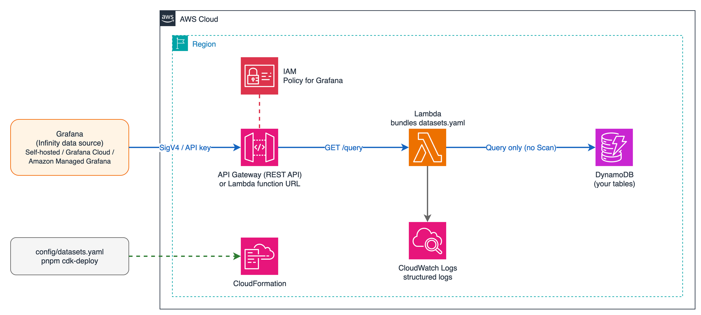

# timeseries-dataset-api-for-amazon-dynamodb

English | [日本語](README.ja.md)

[](https://github.com/furuya02/timeseries-dataset-api-for-amazon-dynamodb/actions/workflows/ci.yml)
[](LICENSE)

An API for reading time-series data in Amazon DynamoDB from Grafana (with the Infinity data source).
You describe "which table, which keys, and which attributes to return" in a single configuration file (`config/datasets.yaml`) and deploy it with the AWS CDK.



## Features

- **Works with any Grafana**: it is an API, not a plugin, so self-hosted Grafana, Grafana Cloud, and Amazon Managed Grafana can connect through the Infinity data source
- **One configuration file**: describe your table design (prefixed keys, composite sort keys, date-split keys, GSIs, ISO 8601 / epoch) in `datasets.yaml`. Errors are listed at `cdk synth` time
- **No Scan**: only the DynamoDB Query API is used. You can limit the time range, items, pages, and consumed RCUs
- **Aggregation on the API side**: downsampling (avg / min / max / sum / count / last) and latest-value lookups run in the API, and the queries work with Grafana alerting
- **Least privilege**: the Lambda function gets only `dynamodb:Query` on the configured tables, and Grafana gets only the permission to call the API
- **Ready to try**: sample data, a dashboard, an alert rule, a local Grafana setup, and a command that drafts a definition from an existing table are included

## Quick start

Requirements: Node.js 22+, pnpm 10+, Docker, AWS CLI, and an AWS account bootstrapped for the CDK.

```bash
git clone https://github.com/furuya02/timeseries-dataset-api-for-amazon-dynamodb.git
cd timeseries-dataset-api-for-amazon-dynamodb
pnpm install

# Deploy with the sample table and an IAM user for Grafana, then load sample data
pnpm cdk-deploy -c sample=true -c grafanaUser=true
pnpm seed
pnpm check            # check the API responses without Grafana

# Create an access key for Grafana and start a local Grafana (OSS 13.3.0 + Infinity 4.1.5)
aws iam create-access-key --user-name timeseries-dataset-api-grafana
export TSAPI_AWS_ACCESS_KEY_ID=AKIA... TSAPI_AWS_SECRET_ACCESS_KEY=...
pnpm grafana-config
pnpm grafana-up       # http://localhost:3000/
```

See [Getting started](docs/en/01-getting-started.md) for an explanation of each step and for trying it with DynamoDB Local without AWS. Checking with the sample cost less than $0.1 (ap-northeast-1, November 2026). When you are done, [clean up](docs/en/06-operations.md#65-clean-up).

## Configuration example

```yaml
datasets:
  room_temp:
    table: iot-metrics
    partitionKey: { name: pk, template: "room#{key}" }
    sortKey: { name: sk, format: iso8601, prefix: "TEMP#" }
    keys: { pattern: "^[a-z0-9-]{1,32}$" }
    fields:
      - { name: temperature, unit: celsius }
      - { name: humidity, scale: 0.1, unit: percent }
    limits: { maxRange: 31d, maxRcu: 500 }
```

```
GET /query?dataset=room_temp&key=a,b&from=${__from}&to=${__to}&interval=${__interval_ms}&agg=avg
```

## Documentation

| | |
|---|---|
| [1. Getting started](docs/en/01-getting-started.md) | From deployment to a Grafana dashboard, and trying it without AWS |
| [2. Defining datasets](docs/en/02-datasets.md) | `pnpm init-dataset`, examples by table design, configuration reference |
| [3. Connecting Grafana](docs/en/03-grafana.md) | Self-hosted, Grafana Cloud, Amazon Managed Grafana |
| [4. Panels and alerts](docs/en/04-panels-and-alerts.md) | Queries, template variables, aggregation, latest values, alerting |
| [5. Deployment options](docs/en/05-deployment-options.md) | Exposure (REST API / function URL / private API), IAM / API key |
| [6. Operations and troubleshooting](docs/en/06-operations.md) | Logs, cost, limits, errors, clean up |
| [7. API reference](docs/en/07-api-reference.md) | `/query`, `/datasets`, `/keys`, errors |
| [8. Development](docs/en/08-development.md) | Structure, tests, CI, releases |

## Tested environment

| | Version |
|---|---|
| Node.js / pnpm | 22.23.4 / 10.24.0 (CI runs Node.js 22 and 24) |
| AWS CDK | aws-cdk-lib 2.275.0, CLI 2.1147.0 |
| AWS SDK for JavaScript | 3.1161.0 (the Lambda function uses the SDK bundled in the runtime) |
| Grafana / Infinity | Grafana OSS 13.3.0 / Infinity 4.1.5 |
| DynamoDB Local | 3.3.2 |

Connections from Grafana Cloud and Amazon Managed Grafana have not been tested yet ([Connecting Grafana](docs/en/03-grafana.md)).

## Contributing

Issues and pull requests are welcome. See [CONTRIBUTING.md](CONTRIBUTING.md). Please report vulnerabilities as described in [SECURITY.md](SECURITY.md). The change history is in [CHANGELOG.md](CHANGELOG.md).

## License and trademarks

MIT License ([LICENSE](LICENSE))

Licenses of the main dependencies: aws-cdk-lib, constructs, AWS SDK for JavaScript, @smithy/signature-v4, @aws-crypto/sha256-js (Apache-2.0), zod (MIT), yaml (ISC). Grafana OSS (AGPL-3.0) and Infinity (Apache-2.0), referenced by `grafana/docker-compose.yml`, are not included in this repository.

The Grafana Labs Marks are trademarks of Grafana Labs, and are used with Grafana Labs' permission. We are not affiliated with, endorsed or sponsored by Grafana Labs or its affiliates.

Amazon Web Services, AWS, Amazon DynamoDB, and Amazon Managed Grafana are trademarks of Amazon.com, Inc. or its affiliates. This repository is not provided or endorsed by Amazon Web Services.
